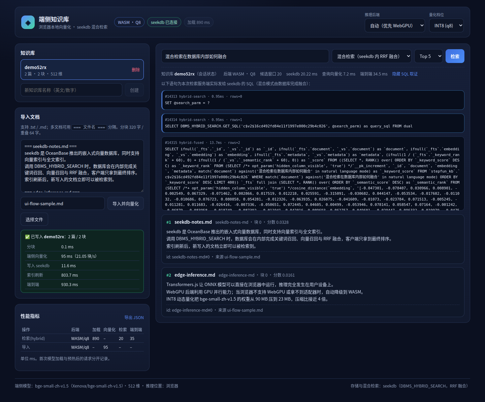

# 端侧知识库：浏览器向量化 + seekdb 混合检索

> 赛题：seekdb × 阶跃星辰「端侧 AI 推理性能优化与 seekdb 混合检索」
> 资产目录：`stepfun/` · 分支：`2026-competition-ecosystem`

一个可运行的迷你知识库：文档在**浏览器**里被编码成向量（Transformers.js + ONNX Runtime Web，WebGPU 优先、WASM 自动降级，INT8/FP16 量化），向量与原文写入 **seekdb**，查询同样在浏览器里向量化，再由 **seekdb 的 `DBMS_HYBRID_SEARCH`** 一次完成向量 + 全文召回与 RRF 融合排序。



- 架构设计：[docs/ARCHITECTURE.md](docs/ARCHITECTURE.md)
- 一页技术说明：[docs/TECHNICAL_NOTE.md](docs/TECHNICAL_NOTE.md)
- 合规对照（逐条验收项 → 证据）：[docs/COMPLIANCE.md](docs/COMPLIANCE.md)
- 复现步骤：[docs/REPRODUCE.md](docs/REPRODUCE.md)
- 实测结果：[docs/RESULTS.md](docs/RESULTS.md)
- 进度日志：[docs/PROGRESS.md](docs/PROGRESS.md)

## 1. 功能对照赛题

| 赛题要求 | 实现 |
|---|---|
| 导入文本 → 本地向量化 → 写入 seekdb → 检索 | 完整链路见 `web/src/App.tsx`、`server/lib/kb.mjs` |
| 文档与查询 embedding 全部在浏览器完成 | `web/src/lib/embedder.worker.ts`（Web Worker），服务端无任何推理依赖 |
| 禁止云端推理 API | 模型权重由本地静态目录 `/models` 提供；无外部推理调用 |
| 优先 WebGPU，缺失时自动降级 WASM 并提示 | `web/src/lib/backend.ts` 真实 `requestAdapter()` 探测 + worker 预热失败再降级；顶栏徽标显示当前后端 |
| INT8 或 FP16 量化 + 体积/压缩比/质量变化 | `q8`、`fp16`、`fp32` 三档可切换；`scripts/fetch_models.mjs` 实测体积，`scripts/bench.mjs` 测质量 |
| 向量 + 原文 + 元数据存于 seekdb | 集合表：`id / document / embedding VECTOR(512) / metadata JSON` |
| 混合检索由 seekdb 完成 | `collection.hybridSearch()` → `DBMS_HYBRID_SEARCH` + RRF，客户端不拼合两路结果；可在界面“查看 SQL 取证” |
| 增量写入 + 索引刷新后可见 | 按 `docId` 删除旧分块后批量 upsert，`refresh_index()` 后立即可检索 |
| 会话/集合状态一致 | `app_sessions` 表持久化会话→知识库绑定，检索以服务端会话为准 |
| 性能优化前后实测 | 批处理、合并刷新、量化三组对比见 [docs/RESULTS.md](docs/RESULTS.md) |

## 2. 快速开始

前置：Node.js ≥ 20、Chromium 内核浏览器（Chrome / Edge 最新版）、Linux/macOS。

```bash
cd stepfun
npm install                 # 已配置 .npmrc(legacy-peer-deps)；如遇 onnxruntime-node 脚本下载失败可加 --ignore-scripts
npm run fetch-models        # 下载 bge-small-zh-v1.5 的 fp32/fp16/INT8 ONNX 权重到 models/（约 160MB）
bash scripts/seekdb_server.sh start   # 启动本地 seekdb（默认 127.0.0.1:2895）
npm run build               # 构建前端到 web/dist
npm start                   # 启动服务：http://127.0.0.1:5177
```

打开 <http://127.0.0.1:5177>：

1. 在「知识库」里创建 `demo`；
2. 在「导入文档」粘贴文本或选择 `.md/.txt` 文件 → 自动分块、端侧向量化、写入 seekdb 并刷新索引；
3. 在检索框输入问题 → 选择「混合检索」→ 查看排序结果、分阶段耗时，以及「查看 SQL 取证」里的 `DBMS_HYBRID_SEARCH` 语句。

开发模式（前端热更新）：`npm run dev`（自动拉起 seekdb + API + Vite，端口 5178）。

### seekdb 说明

`scripts/seekdb_server.sh` 会依次寻找 `SEEKDB_BIN`、`bin/seekdb`、`pylibseekdb` 包内的 `seekdb` 可执行文件。首次使用可：

```bash
python3 -m venv .venv && .venv/bin/pip install pylibseekdb==1.4.0.post2
bash scripts/seekdb_server.sh start
```

连接配置（可用环境变量覆盖）：`SEEKDB_HOST=127.0.0.1`、`SEEKDB_PORT=2895`、`SEEKDB_USER=root`、`SEEKDB_DATABASE=stepfun_kb`。

## 3. 目录结构

```
stepfun/
├─ server/              Node API（只做数据库读写，无推理）
│  ├─ index.mjs         路由 / 静态资源 / COOP+COEP 头
│  └─ lib/              db / kb / session / search / metrics / evidence
├─ web/                 React + Vite 前端
│  ├─ src/lib/          embedder.worker.ts（端侧推理）、backend.ts（探测/降级）、chunk.ts
│  └─ src/components/   Header / KbBar / ImportPanel / SearchPanel / ResultList / MetricsPanel
├─ scripts/             seekdb 启动、模型获取、ORT 运行时准备、基准、评测、冒烟
├─ eval/                评测语料（12 篇）与查询集（14 条，含相关性标注）
├─ automation/          每小时合规检查脚本与报告
├─ results/             实测数据（模型体积、bench、质量、优化对比、截图）
└─ docs/                架构、技术说明、合规、复现、结果、进度
```

## 4. 复现与验证命令

```bash
npm run smoke -- --backend=auto          # 端到端冒烟（真实 Chromium，自动降级 WASM）
npm run bench -- --backend=wasm --dtypes=q8,fp16,fp32 --repeats=3   # 分阶段计时 + 质量对比
node scripts/optimizations.mjs           # 批处理 / 合并刷新 优化前后对比
node automation/hourly_check.mjs         # 合规自检（每小时自动执行）
```

强制指定后端便于验证降级路径：`http://127.0.0.1:5177/?backend=wasm&dtype=q8`。

## 5. 已知限制

- 本机（无物理 GPU 的无头 Linux）主数据来自 WASM；WebGPU 路径已用 SwiftShader 软件适配器跑通（端到端 129.75 ms，吞吐不具参考价值），真实 GPU 加速比需在目标设备复测。
- 首次使用需要下载模型（约 160MB）；模型文件不进入 git，由 `npm run fetch-models` 获取。
- 单机评测语料为 12 篇中文技术文档，规模小，Recall 已接近饱和；量化质量差异主要体现在向量一致性与更大规模语料上（见 RESULTS）。
- seekdb 以本地 server 模式部署（`scripts/seekdb_server.sh`），Linux 需要 `libaio`；如使用嵌入式模式可设置 `SEEKDB_PATH`。
